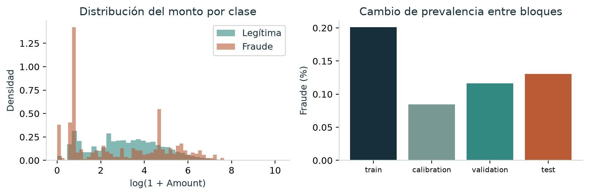
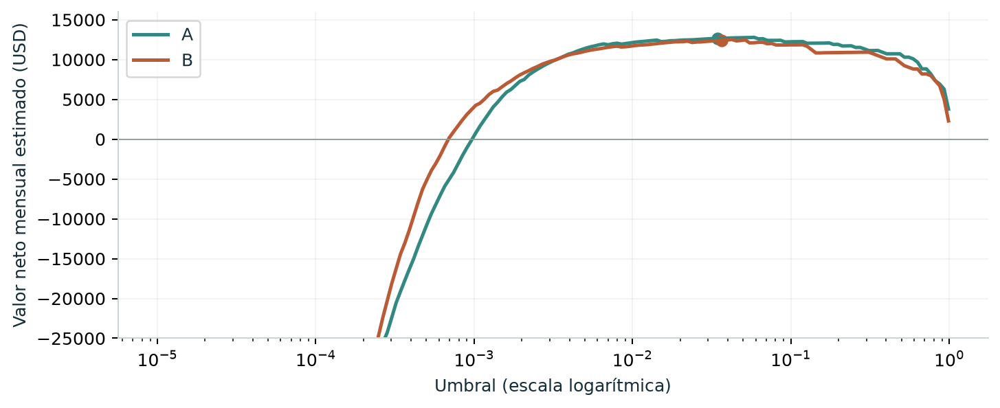
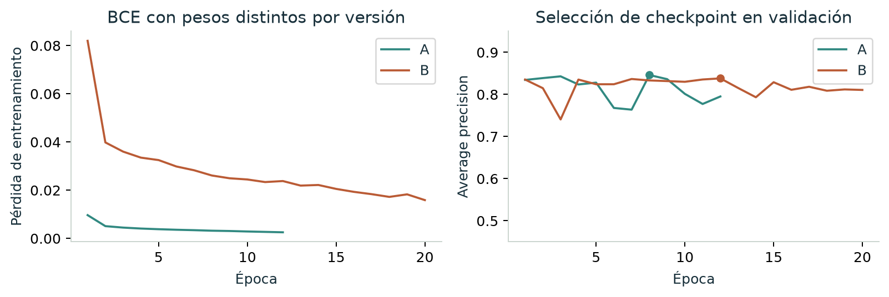
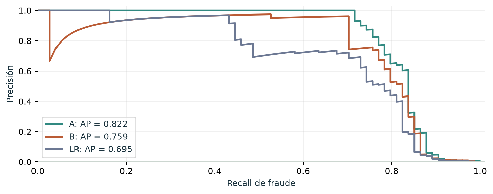
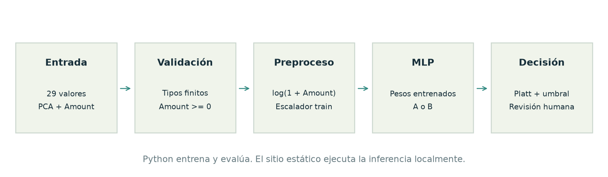
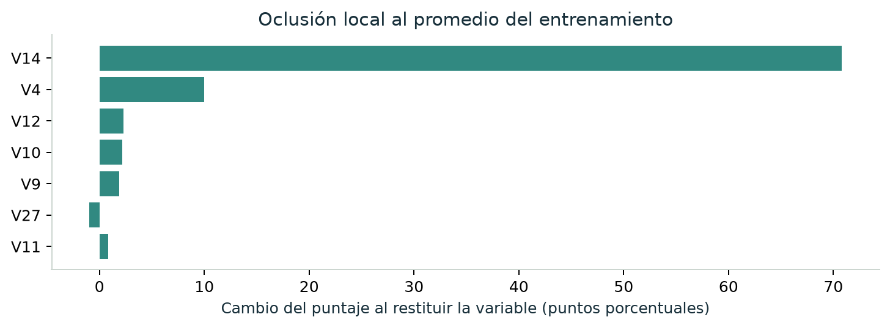
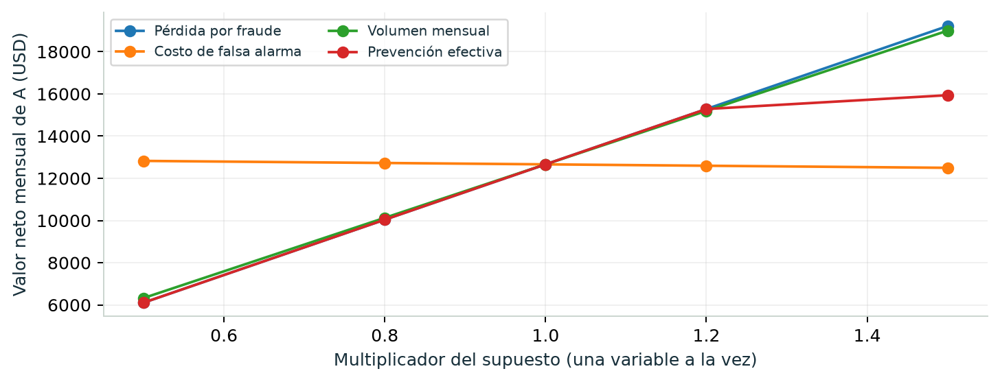

# FraudLens

CC3092 Deep Learning y Sistemas Inteligentes

Javier Valladares 23045
Ian Cumes 23236

Fecha: 19 de octubre de 2026

CC3092 / DEEP LEARNING Y SISTEMAS INTELIGENTES

Detección de fraude y valor económico
de las decisiones de un modelo

Javier Valladares **23045**
Ian Cumes **23236**

| Experimento | Resultado medido en prueba |
| --- | --- |
| Modelo seleccionado en validación | MLP A, 1,505 parámetros |
| Fraudes detectados | 62 de 74 (83.78%) |
| Falsas alarmas | 62 de 56,672 transacciones legítimas |
| Valor neto mensual estimado | US$12,662.02 para 100,000 transacciones |

Pregunta central: ¿cuánto valor cambia al mejorar un modelo o ajustar su umbral de decisión?

Los resultados técnicos se calcularon con un experimento ejecutado. Los costos y el volumen representan un escenario hipotético. El proyecto no reporta un piloto bancario ni ahorro observado.

Versión de trabajo: 19 de octubre de 2026. Entrega indicada: 18 de noviembre de 2026.

## 4.1 Contexto de negocio y problema

El usuario objetivo es un analista de riesgo de un procesador de pagos. El proceso propuesto recibe una transacción anonimizada, calcula un puntaje de fraude y decide si genera una alerta para revisión humana. El escenario es realista, sin una entidad financiera participante ni acceso a pagos reales.

### Línea base y alcance

La línea base económica aprueba todas las transacciones. No incurre en falsas alarmas ni revisión, pero asume la pérdida de los fraudes. Se usa como referencia analítica, no como descripción de la operación de un banco. Con la prevalencia del test, 100,000 transacciones mensuales y una pérdida supuesta de US$150 por fraude, su pérdida esperada es US$19,560.85 al mes.

El sistema produce alertas. La intervención posterior se modela con una efectividad de prevención de 80%. Un verdadero positivo no equivale automáticamente a recuperar dinero. Las falsas alarmas consumen tiempo y pueden molestar a clientes legítimos.

| KPI | Referencia | Política A estimada |
| --- | --- | --- |
| Recall de fraude | 0% al aprobar todo | 83.78% |
| Fraudes sin alerta / mes | 130.41 | 21.15 |
| Alertas por revisar / mes | 0 | 218.52 |
| Valor incremental / mes | US$0 | US$12,662.02 |

### Justificación y alternativa simple

Un MLP puede aprender relaciones no lineales entre componentes PCA. La hipótesis se contrasta con regresión logística, entrenada sobre el mismo bloque y evaluada con la misma función de valor. En test, A mejora la AP de 0.695 a 0.822 y el valor puntual en US$1,468.83. Esto apoya experimentar con una red pequeña, aunque no demuestra superioridad universal.

La exactitud de predecir siempre “legítima” alcanza 99.87% en test. Por eso la evaluación prioriza average precision (AP), recall, precisión y consecuencias económicas. El alcance excluye autorización de pagos y decisiones sobre titulares identificables.

## 4.2 Datos y división temporal

Se utiliza Credit Card Fraud Detection, atribuido a ULB y Worldline, con transacciones europeas de dos días de septiembre de 2013 [1]. Se descargó la copia CSV enlazada por el tutorial oficial de TensorFlow [2]. El archivo contiene Time, V1 a V28, Amount y Class. Las V son componentes PCA anonimizados. Class es la etiqueta y nunca se incorpora a las entradas.

| Control de calidad | Resultado |
| --- | --- |
| Filas originales / fraudes | 284,807 / 492 |
| Nulos en el archivo | 0 |
| Duplicados de entradas eliminados | 1,081 (incluyen 19 filas fraudulentas) |
| Filas limpias / fraudes | 283,726 / 473 |
| Desbalance limpio | 0.1667% de fraude |
| Formato y licencia | CSV; base ODbL y contenidos DbCL según Kaggle [1,3] |

| Bloque | Filas | Fraudes | Prevalencia | Rango Time |
| --- | --- | --- | --- | --- |
| train | 170,235 | 342 | 0.20% | 0 - 120392 |
| calibration | 28,372 | 24 | 0.08% | 120393 - 132905 |
| validation | 28,373 | 33 | 0.12% | 132906 - 145233 |
| test | 56,746 | 74 | 0.13% | 145234 - 172792 |

La división respeta el tiempo: 60% entrenamiento, 10% calibración, 10% validación y 20% test, con cortes sin separar un mismo segundo. Se elimina duplicación antes de dividir y se preserva source_row para auditar el origen. El StandardScaler se ajusta exclusivamente con entrenamiento. No se balancean ni se sobremuestrean los conjuntos de evaluación.

La anonimización impide separar por tarjeta o titular. Tampoco se conoce cómo se ajustó el PCA original. La partición temporal reduce fuga del experimento, pero no garantiza independencia entre personas ni elimina posibles limitaciones del preprocesamiento realizado por la fuente.

## 4.2 Análisis exploratorio y preparación

Figura 1. Los montos muestran asimetría y colas largas. La prevalencia cambia entre los bloques temporales: entrenamiento contiene 0.2009% de fraude y test 0.1304%. Esta diferencia justifica conservar el orden temporal y medir degradación por bloque.

| Monto, unidad original | Medición en datos limpios |
| --- | --- |
| Mediana | 22.00 |
| Percentil 95 | 365.34 |
| Percentil 99 | 1,018.97 |
| Máximo | 25,691.16 |

El preprocesamiento aplica log(1 + Amount) y estandariza las 29 entradas con media y desviación del train. No elimina valores extremos: pueden representar fraude o transacciones legítimas importantes. Time se usa para la separación y se excluye del modelo, evitando que una tendencia de tiempo absoluta domine la inferencia.

Los costos económicos se expresan en USD como parámetros del escenario. Amount conserva la unidad original y no se utiliza como conversión monetaria ni como pérdida económica observada. La pérdida constante simplifica la comparación, pero omite que cada transacción tiene una exposición distinta.

El conjunto cubre dos días, una población europea y patrones de 2013. Su representatividad para Guatemala en 2026 es limitada. Se necesita un nuevo periodo de evaluación con operaciones locales antes de hacer afirmaciones sobre una institución concreta.

## 4.3 Función de valor y supuestos

Para un conjunto de n transacciones, un umbral t define VP, FP, FN y VN. La función estima valor incremental mensual frente a aprobar todo:

**V(t) = (N/n) [VP(t) · L · q - FP(t) · Cfp
- (VP(t) + FP(t)) · Cr] - N · Ci - H**

N es volumen mensual, L pérdida por fraude, q prevención efectiva tras una alerta, Cfp costo adicional de falsa alarma, Cr revisión de cualquier alerta, Ci costo unitario de inferencia y H operación fija. La pérdida residual es (N/n)[FN + (1-q)VP]L. Esta identidad permite contrastar el ahorro con la diferencia de costos totales.

| Parámetro | Valor | Fundamento |
| --- | --- | --- |
| N | 100,000 / mes | Volumen hipotético de un procesador pequeño |
| L | US$150 | Escenario redondeado, sin estimación de una entidad |
| q | 80% | Efectividad hipotética de la intervención |
| Cfp | US$3 | Fricción y atención adicional supuestas |
| Cr | US$0.50 / alerta | Revisión hipotética de VP y FP |
| Ci | US$0.00002 / transacción | Costo asignado, sin factura observada |
| H | US$10 / mes | Presupuesto supuesto, sin cotización |

Todos los parámetros de la tabla son estimaciones de diseño. La fuente de cada uno es el escenario definido para este proyecto, no estadísticas bancarias. Para justificarlos operativamente se debe cronometrar revisión, estimar el margen perdido por fricción, medir recuperación real y cotizar alojamiento. La demo permite modificar N, L, Cfp y q.

El modelo no incluye desarrollo, soporte, regulación, capital, pérdida por abandono futuro ni colas de revisión. Por tanto, V representa contribución operativa incremental bajo supuestos y no utilidad contable ni retorno completo de inversión.

## 4.3 Curva de valor y punto de operación

Figura 2. Exploración retrospectiva del test. Los puntos marcan umbrales elegidos previamente en validación. No se usa esta curva para volver a optimizarlos. Los umbrales se buscaron entre todos los puntajes distintos de validación, incluyendo la opción de no alertar.

| Política de A | F1 test | Recall | VP / FP | Valor / mes |
| --- | --- | --- | --- | --- |
| Umbral 0.5 | 0.816 | 68.92% | 51 / 0 | US$10,727.96 |
| Umbral 0.03461 | 0.626 | 83.78% | 62 / 62 | US$12,662.02 |

Al reducir el umbral, A encuentra 11 fraudes adicionales y genera 62 falsas alarmas en test. Bajo los supuestos, el incremento es US$1,934.06 al mes, aunque F1 cae. El resultado demuestra que maximizar F1 y maximizar valor responden a objetivos diferentes.

Con probabilidades perfectamente calibradas y costos constantes, conviene alertar cuando p &gt; (Cfp + Cr)/(Lq + Cfp), equivalente a 0.02846 en el escenario base. La selección empírica fija tA = 0.034611 y tB = 0.036738. La diferencia puede reflejar error de calibración y el bajo número de fraudes en validación.

A y B tienen el mismo recall en el punto elegido, pero B genera 39 falsas alarmas adicionales. Su diferencia puntual de valor mensual es -US$240.55. La incertidumbre de esa diferencia se presenta en la sección de resultados.

## 4.4 Metodología de desarrollo

| Decisión | MLP A | MLP B |
| --- | --- | --- |
| Arquitectura | 29-32-16-1 | 29-64-32-16-1 |
| Activación / salida | ReLU / logit binario | ReLU / logit binario |
| Pérdida | BCEWithLogitsLoss | BCE ponderada, peso positivo 22.288 |
| Dropout / parámetros | 0 / 1,505 | 0.15 / 4,545 |
| Épocas / checkpoint elegido | 12 / época 8 | 20 / época 12 |
| Optimizador / tasa | AdamW / 0.001 | AdamW / 0.001 |

Ambas versiones usan batch 1,024, weight decay 0.0001, clip de gradiente 5 y semilla 23045. La salida inicial incorpora el prior del train. El checkpoint se escoge por AP de validación. Después, una regresión logística unidimensional ajusta el logit (Platt) usando únicamente el bloque de calibración. El umbral y la selección entre redes se fijan con valor en validación.

La búsqueda es acotada a dos configuraciones predefinidas, sin afirmar una optimización extensa. B cambia capacidad, dropout y peso de clase a la vez, por lo que no permite atribuir su resultado a un único factor. La pérdida ponderada facilita aprender la clase minoritaria, pero no incorpora exactamente los costos del negocio. La alineación económica ocurre principalmente en la selección del umbral.

Figura 3. Las pérdidas de A y B usan pesos distintos y no son comparables en magnitud. En B, la AP oscila y no mejora tras la época 12 aunque la pérdida baja. Se conserva el checkpoint con mejor AP. No se usan modelos preentrenados, APIs de LLM ni GPU.

## 4.5 Resultados de las iteraciones

| Modelo | AP test | Precisión | Recall | F1 | Valor / mes |
| --- | --- | --- | --- | --- | --- |
| LR | 0.695 | 66.67% | 72.97% | 0.697 | US$11,193.20 |
| A | 0.822 | 50.00% | 83.78% | 0.626 | US$12,662.02 |
| B | 0.759 | 38.04% | 83.78% | 0.523 | US$12,421.48 |

| Modelo / bloque | AP | F1 | Recall | Valor / mes |
| --- | --- | --- | --- | --- |
| A / train | 0.835 | 0.787 | 87.72% | US$20,800.41 |
| A / validation | 0.846 | 0.598 | 87.88% | US$11,770.33 |
| A / test | 0.822 | 0.626 | 83.78% | US$12,662.02 |
| B / train | 0.837 | 0.778 | 90.94% | US$21,519.12 |
| B / validation | 0.838 | 0.472 | 87.88% | US$11,449.60 |
| B / test | 0.759 | 0.523 | 83.78% | US$12,421.48 |

Figura 4. PR-AUC se reporta como average precision de scikit-learn, no como integración trapezoidal. El punto operativo de A tiene matriz VP=62, FP=62, FN=12, VN=56,610. La red A supera a la referencia clásica en AP y valor puntual, mientras LR obtiene mayor F1 al ser más conservadora.

La selección de A ocurrió con validación: US$11,770.33 frente a US$11,449.60 de B. El valor en entrenamiento no se usa como pronóstico mensual: sus prevalencias difieren entre bloques.

## 4.5 Incertidumbre y costo computacional

| Indicador | Estimación | Intervalo bootstrap 95% |
| --- | --- | --- |
| AP A | 0.822 | 0.738 - 0.881 |
| AP B | 0.759 | 0.671 - 0.847 |
| Valor mensual A | US$12,662.02 | US$9,310.51 - US$16,018.67 |
| Valor mensual B | US$12,421.48 | US$9,027.10 - US$16,150.84 |
| Diferencia B - A | -US$240.55 | -US$866.29 a +US$366.70 |

Los intervalos usan remuestreo pareado de filas del test: 400 réplicas para valor y 100 para AP, semilla 23045. Mantienen fijos modelo, calibración, umbral y costos. No incluyen incertidumbre por reentrenamiento, supuestos o dependencia temporal. El intervalo B-A incluye cero: esta corrida no establece una diferencia económica concluyente entre ambas redes.

| Costo medido / estimado | A | B |
| --- | --- | --- |
| Entrenamiento de todas las épocas | 1.253 s | 4.789 s |
| Inferencia PyTorch p50 / p95 | 0.0141 / 0.0150 ms | 0.0260 / 0.0663 ms |
| Throughput batch, solo red | 32,260,375 / s | 12,891,568 / s |
| Costo train a US$0.10 / CPU-h | US$0.000035 | US$0.000133 |

El benchmark usa CPU arm64, PyTorch con 4 hilos, 50 calentamientos y 500 inferencias unitarias sin gradientes. Throughput se calcula sobre un único batch de 56,746 entradas y no representa capacidad de una API ni incluye red, parseo, preproceso, descargas o concurrencia. Los tiempos cortos dependen fuertemente del equipo. El costo de entrenamiento es una imputación hipotética y excluye preparación, calibración y evaluación.

La inferencia JS se contrastó en 16 ejemplos de test para ambas redes: diferencia máxima absoluta 2.03e-7 frente a PyTorch. Cuatro pruebas verifican contabilidad, umbrales y sensibilidad. También se verifican rechazo de entradas inválidas y paridad de valor entre Python y JS.

## 4.6 Despliegue y experiencia de usuario

Figura 5. Flujo de inferencia de la aplicación desplegada. La etiqueta de referencia queda fuera del cálculo de la predicción.

La aplicación estática contiene el escalador, los pesos y la calibración exportados a JSON. El navegador recibe 29 valores, valida su tipo, transforma Amount y ejecuta las capas del MLP. La etiqueta del ejemplo permanece fuera del cálculo de la predicción y solo se muestra a solicitud del usuario. El sitio genera una recomendación de revisión, sin ejecutar pagos.

Demo: <link href="https://fraudlens-javier-ian.javiervalladares.chatgpt.site">https://fraudlens-javier-ian.javiervalladares.chatgpt.site</link>. Publicación privada para la cuenta propietaria. Antes de presentar a otra audiencia se debe comprobar el acceso desde el equipo de exposición.

### Flujo utilizable y casos límite

La interfaz ofrece ejemplos del test, entrada JSON, versiones A y B, puntaje calibrado, decisión, oclusión local y simulador económico. Los errores de JSON, campos ausentes, valores no numéricos, infinitos y Amount negativo se rechazan. Los valores fuera de rango de train generan una advertencia. La detección de rangos no sustituye una evaluación formal de datos fuera de distribución.

La prueba manual observó una entrada legítima sin alerta y una fraudulenta con alerta (TX-229712, puntaje A 97.6%). El usuario puede editar una entrada: entonces se deshabilita revelar una etiqueta inexistente. Se comprobó el cambio de modelo y extremos del umbral. Estos ejemplos verifican funcionamiento y no constituyen una prueba de usabilidad con analistas.

### Monitoreo propuesto

En una integración futura se registrarían versiones, distribución de puntajes, porcentaje de alertas, tiempos p50/p95 y etiquetas con retraso, sin datos de tarjeta. Revisiones semanales compararían AP, recall y valor con sus intervalos y con periodos anteriores. Un aumento sostenido de falsas alarmas o cambios de distribución activaría revisión del modelo. El prototipo no implementa una plataforma de monitoreo en producción.

## 4.7 Explicabilidad, ética y riesgos

Figura 6. Explicación aplicada a TX-229712 mediante oclusión de cada variable al promedio del train. V14 tiene el mayor efecto local en A. La perturbación mide sensibilidad del puntaje, no causalidad. Al ser componentes PCA, no se puede interpretar V14 como una característica humana o comercial específica. Sustituir un componente por la media puede producir combinaciones poco probables.

| Subgrupo por monto | n / fraudes | Recall A | Precisión A |
| --- | --- | --- | --- |
| monto <= 20 | 29,994 / 48 | 85.42% | 52.56% |
| 20 < monto <= 100 | 16,860 / 11 | 90.91% | 52.63% |
| monto > 100 | 9,892 / 15 | 73.33% | 40.74% |

La auditoría por monto explora heterogeneidad, pero las muestras positivas son pequeñas. El archivo no permite evaluar equidad por género, edad, etnia o ubicación. No se asume ausencia de sesgos a partir de la anonimización. Un falso negativo puede afectar al titular y al comercio. Una falsa alarma puede retrasar un pago o imponer verificaciones adicionales.

El uso previsto requiere revisión humana de alertas. No se debe usar este prototipo para decisiones automáticas sobre cuentas, acusaciones de fraude o exclusión de clientes. Los componentes PCA públicos no permiten desplegar directamente sobre datos de un banco: se necesitaría acceso autorizado al esquema y transformación equivalente, además de una nueva evaluación.

La demo procesa las entradas localmente y no implementa persistencia de transacciones. Los datos del benchmark no contienen números de tarjeta. El repositorio conserva atribución y descarga reproducible, sin incluir el CSV original completo. Los ejemplos públicos conservan referencia a ULB/Worldline y a los términos de los datos [1,3].

## 4.8 Discusión y conclusiones

Figura 7. Sensibilidad de una variable por vez con la política A fija. Se prueban factores 0.5, 0.8, 1, 1.2 y 1.5. La prevención efectiva se limita a 100%, por lo que 1.5 veces 80% se trunca a 100%. El análisis no reoptimiza umbrales en test y no representa escenarios conjuntos.

**Hallazgo principal.** Ajustar el umbral por costo aumenta el valor puntual de A en US$1,934.06 al mes frente a t=0.5, pese a reducir F1. En este escenario, los fraudes adicionales detectados compensan las falsas alarmas. Cambiar a una red más grande no mejora el resultado: B detecta el mismo número de fraudes y produce más falsas alarmas.

**Rendimientos decrecientes.** A tiene menor costo computacional y mayor valor puntual que B. B necesitaría elevar su contribución en más de US$240.55 al mes, bajo los mismos supuestos, solo para igualar el resultado observado. El intervalo de la diferencia incluye cero y aconseja evaluar más periodos antes de escoger entre ellas por una diferencia pequeña.

**Viabilidad.** Una red pequeña permite una demo económica y reproducible. La principal barrera de producción es obtener datos recientes, medir costos y validar la intervención humana. Se propone recopilar otro periodo con etiquetas retrasadas, ejecutar varias semillas y un piloto en modo sombra, comparar contra reglas y árboles potenciados, y valorar pérdidas por monto con límites de exposición.

La corrida actual usa una sola semilla, 24 fraudes para calibrar, 33 para validación y 74 para prueba. Las conclusiones son del benchmark y del escenario declarado. No se reportan usuarios reales, prueba A/B, transacciones bancarias en vivo ni ahorros observados.

## 4.9 Repositorio y reproducibilidad

El código del proyecto se entrega en la carpeta de trabajo y en un paquete ZIP. El repositorio local incluye descarga, entrenamiento, evaluación, función de valor, pruebas, pesos y código del sitio. La publicación de un repositorio público de GitHub y su enlace definitivo quedan pendientes de la cuenta y visibilidad que elijan los integrantes.

### Secuencia de reproducción

1. Crear un entorno Python 3.12 e instalar requirements.txt.
2. Ejecutar python -m scripts.download_data.
3. Ejecutar python -m scripts.train.
4. Ejecutar python -m scripts.export_web_data.
5. Ejecutar python -m unittest discover -s tests -v y node tests/parity.mjs.
6. Servir site/dist con python -m http.server 8765 --directory site/dist.

SHA-256 del CSV original: 76274b691b16a6c49d3f159c883398e03ccd6d1ee12d9d8ee38f4b4b98551a89

| Entrega solicitada | Estado y evidencia |
| --- | --- |
| Implementación desplegada | Demo privada de FraudLens y código en site/dist |
| Dos versiones de deep learning | Pesos .pt y JSON; resultados A y B calculados |
| Informe escrito | Este documento y fuente editable docs/informe.md |
| Apoyo para presentación | Diapositivas y guía de defensa |
| Video 2 a 4 minutos | Demostración con capturas verificadas, en output/video |
| Repositorio público de GitHub | Pendiente de publicación y enlace definitivo |
| Presentación en vivo | Semana del 16 de noviembre de 2026, turno por confirmar |
| Entrega escrita | Miércoles 18 de noviembre de 2026 |

### Referencias

[1] Machine Learning Group - ULB / Worldline. Credit Card Fraud Detection. Kaggle. https://www.kaggle.com/datasets/mlg-ulb/creditcardfraud
[2] TensorFlow. Classification on imbalanced data. https://www.tensorflow.org/tutorials/structured_data/imbalanced_data
[3] Open Data Commons. ODbL 1.0 y DbCL 1.0. https://opendatacommons.org/licenses/

Los resultados y gráficos de este informe provienen de results/metrics.json, eda.json, history.json, sensitivity.json y test_predictions.csv. Consulta de fuentes y ejecución: 19 de octubre de 2026, hora de Guatemala.
