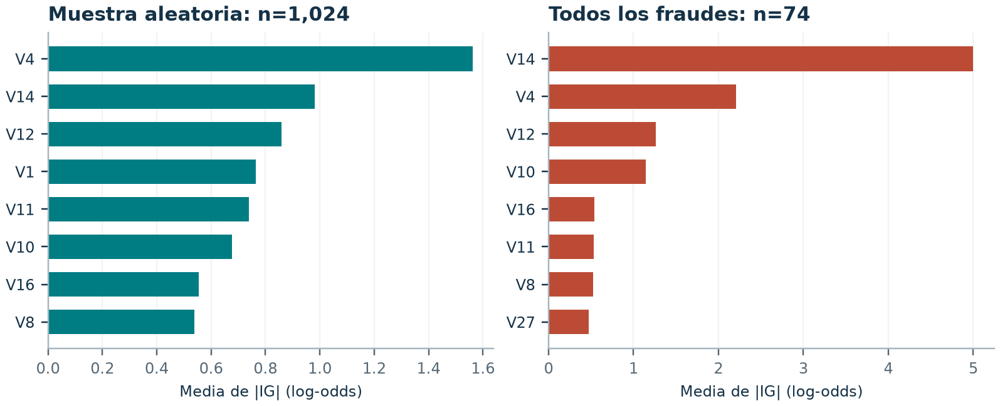
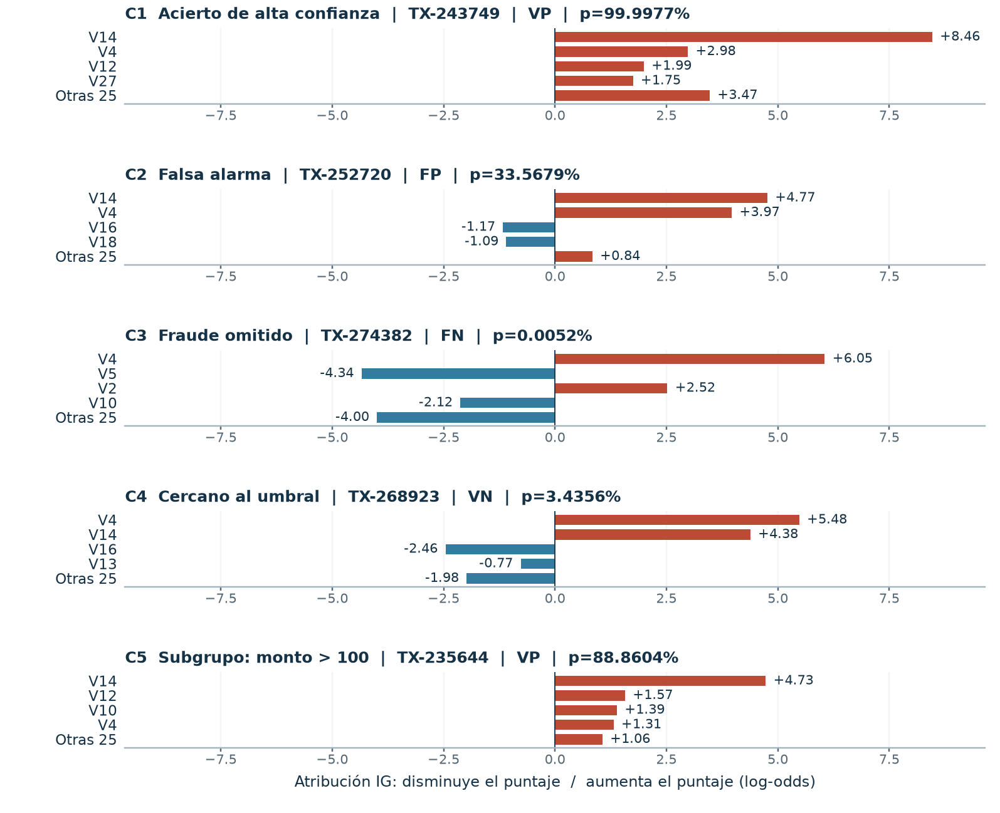
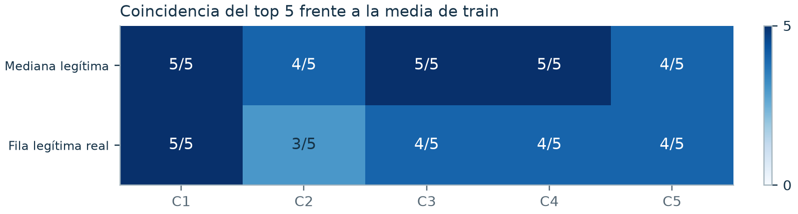

# Laboratorio 10: Explainable AI / FraudLens

CC3092 · DEEP LEARNING Y SISTEMAS INTELIGENTES · LABORATORIO 10

Explicar FraudLens

Javier Valladares · 23045 &nbsp;&nbsp; Ian Cumes · 23236 &nbsp;&nbsp; | &nbsp;&nbsp; 16 de noviembre de 2026

Auditamos el MLP A final, ya entrenado (29-32-16-1, ReLU, 1,505 parámetros), elegido originalmente con validación. Sus entradas son V1-V28 (PCA anónimo) y log(1 + Amount), escaladas con train. Se conservan pesos, calibración Platt, particiones y umbral.

1. Investigación de métodos para datos tabulares

| Método / herramienta | Idea y requisitos | Costo orientativo / limitación |
| --- | --- | --- |
| IG / captum [1,2] | Integra gradientes entre referencia e instancia; necesita acceso a gradientes y línea base. | K evaluaciones con gradientes. Depende de la referencia y de una trayectoria que puede ser artificial. |
| LIME / lime [3] | Ajusta un sustituto local con predicciones de caja negra y un kernel de vecindad. | S inferencias + ajuste. Vecindario, kernel, discretización y semilla alteran la fidelidad local. |
| KernelSHAP / shap [4,5] | Atribuye valores Shapley por coaliciones; requiere consultas al modelo y conjunto de fondo. | Aprox. S x B inferencias. Alto costo; depende del fondo y del tratamiento de dependencias. |
| TreeSHAP / shap [5] | Usa la estructura interna de árboles y una política para variables ausentes. | Algoritmo especializado eficiente. No aplica directamente a nuestro MLP. |
| DeepSHAP y GradientSHAP / shap, captum [2,5] | Reglas tipo DeepLIFT o gradientes esperados sobre un fondo; requieren red/gradientes compatibles. | Propagaciones según B o muestras. Aproximan SHAP; dependen de operaciones, fondo y supuestos. |
| DiCE / dice-ml [6] | Busca entradas cercanas de otra clase; necesita caja negra o gradientes y restricciones de factibilidad. | Búsqueda iterativa. Sin semántica de PCA no podemos proponer acciones factibles sobre sus componentes. |
| Anchors / alibi [7] | Busca reglas suficientes de alta precisión; requiere predicciones y un muestreador. | Consultas adaptativas. Precisión y cobertura valen bajo la distribución de perturbación elegida. |
| Oclusión / PyTorch [2] | Reemplaza una variable por una referencia y mide el cambio de salida; acepta caja negra. | d + 1 inferencias. No descompone aditivamente interacciones; puede producir entradas irreales. |

d = variables; K = puntos de integración; S = coaliciones/perturbaciones; B = tamaño del fondo. Los costos de alternativas son teóricos, no benchmarks ejecutados.

Propiedades y referencia interpretable

IG satisface completitud: la integral exacta cumple suma(IG) = F(x) - F(b). Permite contabilizar la diferencia de puntajes. También satisface sensibilidad e invariancia de implementación para funciones equivalentes con igual referencia/trayectoria. El residuo numérico comprueba la suma; no garantiza exactitud individual ni causalidad. [1]

La regresión logística del proyecto es interpretable por estructura; IG es una explicación a posteriori de A. En test: AP logística/A = 0.6946/0.8222, recall = 72.97%/83.78% y F1 = 0.6968/0.6263, con sus umbrales originales. A mejora detección y AP; la logística obtiene mejor F1. Sus coeficientes tampoco recuperan el significado de los componentes PCA.

---

2. Elección e implementación

| Criterio | IG: método principal | KernelSHAP: alternativa descartada |
| --- | --- | --- |
| Compatibilidad | Acceso directo a gradientes del MLP y calibración en PyTorch. | Compatible como caja negra; no aprovecha los gradientes disponibles. |
| Explicación | Contribuciones firmadas relativas a una referencia; suma verificable en la escala elegida. | Atribuciones Shapley relativas al fondo/juego; exactitud local depende de su estimación. |
| Costo y volumen | 256 puntos; se mide el costo unitario y en lote. Uso propuesto: alertas y auditoría. | S x B consultas para cada caso; mayor volumen de evaluaciones. No se ejecutó benchmark. |
| Comunicación | Barras que elevan o reducen el puntaje para analistas; mostrar p, umbral y referencia. | Barras aditivas familiares, pero requieren explicar también el fondo y la ausencia de variables. |
| Limitaciones | Referencia/recorrido artificiales; las variables PCA carecen de semántica operativa. | Combinaciones de variables irreales y sensibilidad al fondo; no elimina el problema de PCA. |

Se mantiene IG tras usarlo: permite comprobar la contabilidad del puntaje y su costo es viable para auditoría. LIME también se descartó por añadir un sustituto cuya fidelidad depende del vecindario. Ninguno de estos métodos convierte una asociación en causa.

Diseño reproducible

Salida: F(z) = a·MLP(z) + b, log-odds calibrados; p = sigmoid(F). Se incluye Platt y se evita la saturación de la sigmoide en la atribución. Referencia: z = 0, media de train en las entradas transformadas; F(b) = -7.9853, p(b) = 0.0340%. Es una referencia sintética, no ausencia de fraude.

Captum 0.9.0: IG con multiplicador (x-b), trayectoria recta y Gauss-Legendre; 256 puntos por instancia, semilla 23045, CPU, 4 hilos, lotes de 32 ejemplos y batch interno 2048. Refinamiento hasta 1024 si |delta| > 0.02 + 0.001·|F(x)-F(b)|; todos convergieron con 256. Delta máximo = 0.01867, p95 = 0.00588 log-odds. Se verificaron hashes de todos los modelos sin cambios.

Muestra global: 1,024 filas de test sin reemplazo, elegidas al azar antes de ver atribuciones (3 fraudes). Panel adicional: los 74 fraudes de test. No se mezclan sus agregados. IG no usa fondo SHAP; se prueba sensibilidad local con dos referencias alternativas de train.

Figura 1. Media de |IG|. V4 domina en la muestra aleatoria (1.561); V14 en los fraudes (4.997). Las escalas de ambos paneles son distintas. Son influencias sobre el modelo, no significados de negocio ni efectos causales.

---

3. Cinco explicaciones locales

Test original: 56,746 transacciones y 74 fraudes. Se alerta si p ≥ 3.4611% (F ≥ -3.3284). Se seleccionan casos por reglas deterministas, usando etiquetas solo para auditoría.

Figura 2. Rojo: contribución que eleva F; azul: la reduce. Se muestran las cuatro mayores |IG| y la suma firmada de las otras 25. Base común F(b) = -7.9853. VP/VN son aciertos; FP/FN son errores. Cada p es la salida real del modelo, no la suma redondeada de las barras.

| Caso / selección | Monto | F(x) | F(x) - umbral | Delta IG |
| --- | --- | --- | --- | --- |
| C1: VP con mayor p | 1.00 | 10.6634 | +13.9917 | +0.00966 |
| C2: FP con mayor p | 44.76 | -0.6826 | +2.6457 | +0.00557 |
| C3: FN con menor p | 0.00 | -9.8635 | -6.5352 | -0.00672 |
| C4: restante más próximo al umbral | 239.88 | -3.3360 | -0.0077 | +0.00380 |
| C5: VP restante de monto > 100, mayor p | 122.68 | 2.0766 | +5.4049 | +0.00306 |

Lectura: en C1 y C5 domina V14 (+8.46 y +4.73). C4 combina V4/V14 positivos con V16 negativo: queda apenas 0.00766 log-odds bajo el umbral. C3 contiene una señal V4 positiva fuerte, superada por señales negativas. Esto explica por qué una señal aislada no basta para clasificar. El monto de C5 define un subgrupo operativo, no demográfico.

---

4. Interpretación y discusión

Errores, señales y límites de la evaluación

C2: V14 y V4 suman +8.73 log-odds y dominan la falsa alarma. Sustituir solo V14 por su media de train reduce p de 33.57% a 0.368% y corrige la etiqueta. C3: V5/V10 aportan -4.34/-2.12; ninguna sustitución individual corrige el FN (p máxima 0.0238%). Son diagnósticos de entradas sintéticas, no acciones causales factibles ni recomendaciones para modificar transacciones.

No entran Class, Time ni source_row al modelo; el escalador coincide con train y las decisiones coinciden con las predicciones originales. La auditoría halló 648 filas de test con entradas idénticas a train al quitar Time (0 fraudes). No demuestra uso de la etiqueta, pero limita la independencia de la evaluación: la deduplicación original incluía Time. Falta identidad de tarjetas y se desconoce cómo se ajustó el PCA; no se puede descartar fuga previa ni variables proxy. No se asigna semántica inventada a V14/V4.

Estabilidad y decisiones que cambia la explicación

Figura 3. Al usar una fila legítima real de train (source_row 55846), C2 conserva solo 3/5 variables del top 5; con mediana legítima, 4/5. Se mantiene IG, mostrando la referencia y la sensibilidad. La figura mide coincidencia de variables, no de sus magnitudes ni signos.

Proponemos revisión humana para alertas y una banda de incertidumbre cerca del umbral, definida y evaluada en validación. Para el siguiente ciclo: auditar duplicados sin Time y particiones por tarjeta, obtener variables con significado y etiquetas verificadas, y vigilar errores por monto. En monto > 100 el recall es 11/15; en monto ≤ 20, 41/48: son grupos pequeños. No eliminamos V14 por causar una falsa alarma ni ajustamos el umbral con estos casos de test.

El analista vería p, umbral, referencia, contribuciones firmadas y la advertencia de PCA; la etiqueta solo aparece en auditoría. La explicación muestra patrones compartidos entre aciertos/errores y oposición entre señales que AP/F1 no muestran. Confirma heterogeneidad del puntaje, sin validar que las señales tengan sentido semántico en fraude.

Costo y uso responsable

En CPU, 30 repeticiones tras 5 calentamientos: inferencia p50 0.024 ms; IG p50/p95 11.44/11.74 ms; oclusión p50 0.054 ms. El lote de 1,097 casos únicos tardó 2.54 s, solo IG. Se excluyen disco, preproceso y red. Es viable para auditoría o alertas asíncronas; falta medir carga real antes de prometer latencia en producción.

Persisten riesgos de falsas alarmas, fraudes omitidos, proxies desconocidos y cambio de población (benchmark europeo de 2013). No usar para bloquear pagos reales o sancionar personas sin validación y supervisión. Si una alternativa interpretable logra desempeño operativo comparable, la preferiríamos para facilitar control; estos resultados no prueban equivalencia con la logística.

Referencias primarias. [1] Sundararajan et al., ICML 2017 (IG). [2] Captum, documentación de atribución. [3] Ribeiro et al., 2016 (LIME). [4] Lundberg y Lee, NeurIPS 2017 (SHAP). [5] SHAP, API de explainers. [6] Mothilal et al., 2020 (DiCE). [7] Ribeiro et al., 2018 / Alibi (Anchors). Consulta: 16/11/2026. Fuentes y notas ampliadas en explicabilidad/investigacion.md.

Repositorio Git del proyecto: https://github.com/Javiervalladares1/FraudLens
